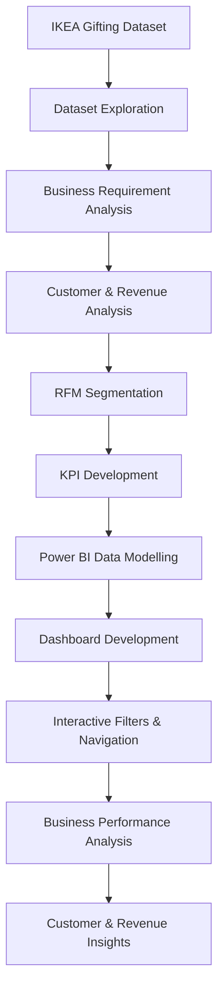

 <p align="center">
  

<h1 align="center">IKEA Customer Analytics</h1>
<h3 align="center">Customer & Revenue Intelligence | Power BI Dashboard</h3>

<p align="center">
  <b>Understand customers. Discover patterns. Drive better business decisions.</b>
</p>


<p align="center">
  
  
  
  
</p>

<p align="center">
  <b>Turning customer data into meaningful business intelligence.</b>
  <br/>
  Exploring customer behaviour, revenue performance, RFM segmentation, and churn patterns through interactive Power BI dashboards.
</p>

---

## 📌 Table of Contents

<details open>
<summary><b>Explore Project Documentation</b></summary>

- [Project Overview](#-project-overview)
- [Business Context & Problem Statement](#-business-context--problem-statement)
- [Project Objectives](#-project-objectives)
- [Dataset Overview](#-dataset-overview)
- [Understanding RFM Analysis](#-understanding-rfm-analysis)
- [Dashboard Architecture](#-dashboard-architecture)
- [Dashboard Walkthrough](#-dashboard-walkthrough)
  - [Landing Page](#1-ikea-customer-analytics-overview)
  - [Business Overview – Customer](#2-business-overview--customer-analysis)
  - [Business Overview – Revenue](#3-business-overview--revenue-analysis)
  - [RFM Analysis – Segment](#4-rfm-analysis--customer-segmentation)
  - [RFM Analysis – Country](#5-rfm-analysis--geographical-analysis)
- [Interactive Features](#-interactive-features)
- [Key Performance Indicators](#-key-performance-indicators)
- [Key Business Observations](#-key-business-observations)
- [Analytical Workflow](#-analytical-workflow)
- [Technology Stack](#-technology-stack)
- [Repository Structure](#-repository-structure)
- [Getting Started](#-getting-started)
- [Business Recommendations](#-business-recommendations)
- [Limitations & Considerations](#-limitations--considerations)
- [Future Enhancements](#-future-enhancements)
- [Author](#-author)

</details>

---

## 🎯 Project Overview

**What if customer data could reveal not just how much a business earns, but also why customers stay, when they return, and which segments contribute the most value?**

This project, **IKEA Customer Analytics**, is an end-to-end business intelligence and customer analytics project designed to explore customer purchasing behaviour, revenue performance, retention patterns, and customer segmentation.

Using Power BI, I developed an interactive dashboard experience that combines business performance monitoring with RFM (Recency, Frequency, Monetary) analysis.

The project transforms transactional customer information into meaningful analytical insights through visual storytelling, KPI tracking, segmentation, and geographical comparisons.

Rather than looking at revenue as an isolated business metric, the dashboard connects revenue performance with customer behaviour to provide a broader understanding of business performance.

### What does this project investigate?

- How many customers contribute to the overall business?
- Which customer segments generate the highest revenue?
- How does customer churn vary across different segments?
- How does revenue change over time?
- Which customer groups demonstrate stronger purchasing behaviour?
- How does customer value differ across countries?
- Which RFM segments require greater attention from a retention perspective?

**Project Focus:** Customer Analytics | Revenue Intelligence | RFM Segmentation | Churn Analysis | Business Intelligence

---

## 💼 Business Context & Problem Statement

For a retail business such as IKEA, understanding customer relationships is just as important as understanding sales performance.

A business may generate substantial revenue while simultaneously experiencing customer attrition. Similarly, not every customer contributes equally to revenue, purchasing frequency, or long-term business value.

Looking at total revenue alone does not provide enough information to understand these patterns.

The central business challenge addressed by this project is:

**How can customer transaction data be transformed into an integrated analytical dashboard that helps understand revenue contribution, customer retention, purchasing behaviour, and customer value?**

To address this challenge, the dashboard brings together five major analytical dimensions:

| Analytical Dimension | Business Perspective |
|---|---|
| Customer Performance | Understand customer distribution and retention |
| Revenue Performance | Evaluate revenue generation across segments |
| Customer Segmentation | Identify customer groups using RFM analysis |
| Churn Analysis | Examine customer attrition patterns |
| Geographical Analysis | Compare customer value across countries |

The result is a unified analytical environment for exploring customer and revenue performance.

---

## 🎯 Project Objectives

The primary objectives of this project are:

1. **Customer Performance Analysis:** Evaluate customer distribution across different segments.
2. **Revenue Intelligence:** Examine revenue contribution across customer categories.
3. **RFM Segmentation:** Understand customer purchasing behaviour through Recency, Frequency, and Monetary metrics.
4. **Churn Analysis:** Investigate customer churn patterns across different time periods and segments.
5. **Time-Series Analysis:** Explore monthly, quarterly, and yearly business performance.
6. **Geographical Analysis:** Compare customer performance and value across countries.
7. **Interactive Reporting:** Build dynamic dashboards using slicers, navigation buttons, and analytical selectors.
8. **Business Storytelling:** Convert analytical findings into understandable visual insights that support business decision-making.

---

## 📊 Dataset Overview

The project uses the IKEA Gifting Dataset, supplied in the repository as a compressed ZIP file.

The dashboard explores customer and transactional information through customer-level and revenue-level aggregations.

| Dataset Component | Description |
|---|---|
| Dataset | IKEA Gifting Dataset |
| File Provided | `IKEA Gifting Dataset.zip` |
| Analytical Focus | Customer and revenue performance |
| Customer Segmentation | RFM |
| Time Dimensions | Month, Quarter, Year |
| Geographical Dimension | Country |
| Business Dimensions | Customer Segment, Churn Status |
| Visualization Platform | Power BI |

**Important:** The original dataset's exact row count, column count, and complete schema are not specified in the dashboard PDF. These have therefore not been assumed.

### Analytical Dimensions

The dashboard uses the following dimensions for interactive analysis:

| Dimension | Analytical Purpose |
|---|---|
| Month | Monthly customer and revenue trends |
| Quarter | Quarterly performance comparison |
| Year | Year-over-year analysis |
| Country | Geographical performance |
| Segment | Customer segment comparison |
| IsChurned | Customer retention and churn analysis |

---

## 🔍 Understanding RFM Analysis

One of the central analytical components of this project is **RFM Analysis**.

RFM is a customer segmentation technique that evaluates customer behaviour using three important dimensions.

<details>
<summary><b>1. Recency (R) – When did the customer last purchase?</b></summary>

Recency measures how recently a customer made a purchase.

It helps understand customer engagement and purchasing activity.

A more recent purchase can indicate stronger recent engagement, while a longer gap may indicate a need for further investigation.

**Business Application:** Identifying customers who may require re-engagement campaigns.

</details>

<details>
<summary><b>2. Frequency (F) – How often does the customer purchase?</b></summary>

Frequency measures the number of purchases made by a customer during the observed period.

It helps distinguish occasional buyers from customers who purchase repeatedly.

**Business Application:** Understanding repeat purchasing behaviour and customer loyalty.

</details>

<details>
<summary><b>3. Monetary (M) – How much value does the customer generate?</b></summary>

Monetary measures the financial contribution associated with a customer's purchases.

It provides insight into customer revenue contribution.

**Business Application:** Identifying customers with higher monetary contribution and evaluating customer value.

</details>

### Why combine R, F, and M?

Looking at these dimensions independently provides only part of the picture.

Combining them creates a more comprehensive customer profile.

| RFM Dimension | Key Question | Business Value |
|---|---|---|
| Recency | How recently? | Customer engagement |
| Frequency | How often? | Purchase consistency |
| Monetary | How much? | Revenue contribution |

The dashboard uses RFM scores to compare customer segments and understand their average Recency, Frequency, and Monetary characteristics.

*Note: The exact scoring thresholds and segment assignment rules should be interpreted from the underlying project model rather than assumed from the exported dashboard.*

---

## 🖥️ Dashboard Architecture

The project is structured around two major analytical modules.

<p align="center">
  <b>IKEA CUSTOMER ANALYTICS</b>
  <br/>
  Customer Understanding & Revenue Intelligence
</p>

```text
                  IKEA CUSTOMER ANALYTICS
                            |
              +-------------+-------------+
              |                           |
       BUSINESS OVERVIEW              RFM ANALYSIS
              |                           |
       +------+-------+             +-----+------+
       |              |             |            |
   Customer        Revenue        Segment      Country
   Analysis        Analysis       Analysis     Analysis
       |              |             |            |
       +--------------+-------------+------------+
                            |
                    BUSINESS INSIGHTS
                            |
              Customer Value & Retention
                  Revenue Performance
```

### Dashboard Design Philosophy

The dashboard follows a consistent visual identity inspired by IKEA's recognizable blue-and-yellow branding.

- Blue represents the primary visual identity.
- Yellow highlights important analytical elements.
- White backgrounds maintain visual clarity.
- KPI cards provide quick access to business performance.
- Consistent filters support cross-page analysis.
- Navigation buttons connect the major analytical modules.

The report is designed to make complex information accessible without overwhelming the user.

---

## 📈 Dashboard Walkthrough

### 1. IKEA Customer Analytics – Overview

The landing page introduces the analytical framework and provides navigation to the two main modules.

**Business Overview**

Focuses on customer distribution, revenue generation, retention, and business performance.

**RFM Analysis**

Focuses on customer purchasing behaviour, segmentation, and customer value.

The landing page also includes a Key Metrics Glossary explaining:

- Churned %
- Recency (R)
- Frequency (F)
- Monetary (M)
- Customer Value

<details>
<summary><b>Explore the landing page</b></summary>

The introductory page acts as the navigation hub for the complete analytical report, helping users understand the purpose of each module before exploring the dashboards.

</details>

### 2. Business Overview – Customer Analysis

This module focuses on customer distribution and retention performance.

**Key Visualizations**

| Visualization | Analytical Purpose |
|---|---|
| Total Customers by Segment | Compares customer distribution across segments |
| Customer Retention by Segment | Compares churned and retained customers |
| Total Customers by Month | Explores monthly customer trends |
| Total Customers by Quarter | Examines quarterly customer patterns |
| Total Customers by Year | Evaluates customer trends across years |

**Key Questions Answered**

- Which customer segment contains the largest number of customers?
- How does customer retention differ across segments?
- Which months show higher customer counts?
- How does customer performance change across quarters and years?

The customer module makes it possible to evaluate customer distribution alongside retention behaviour.

### 3. Business Overview – Revenue Analysis

This module shifts the focus from customer volume to revenue generation.

It allows users to explore how revenue is distributed across segments and how it changes over time.

**Key Visualizations**

| Visualization | Analytical Purpose |
|---|---|
| Total Revenue by Segment | Compares revenue contribution across customer segments |
| Revenue Retention by Segment | Examines revenue distribution across customer segments |
| Total Revenue by Month | Tracks monthly revenue performance |
| Total Revenue by Quarter | Compares quarterly revenue |
| Total Revenue by Year | Examines annual revenue trends |

The dashboard also includes a toggle between Customer and Revenue views, allowing users to explore different business perspectives.

**Analytical Perspective**

Customer volume and revenue contribution are not necessarily proportional.

A segment with a large customer base may not generate the highest revenue. Comparing both dimensions helps reveal differences in customer contribution.

### 4. RFM Analysis – Customer Segmentation

This module explores customer behaviour through RFM segmentation.

The Segment Performance Summary provides a structured comparison of customer segments.

**Metrics Included**

- Total Customers
- Total Revenue
- Average Recency Score
- Average Frequency Score
- Average Monetary Score

The dashboard includes the following customer segments:

| Segment | Analytical Interpretation |
|---|---|
| Champions | A customer group identified as a distinct high-performing segment |
| Loyal | A segment associated with customer loyalty |
| At Risk | A segment requiring closer retention attention |
| New | Recently acquired or newly classified customers |
| Needs Attention | Customers requiring further engagement analysis |
| Lost | A segment associated with inactive or lost customers |

These are the segment labels displayed in the dashboard. Their exact classification thresholds depend on the underlying RFM logic.

**Additional Visualization: Segment by Average Customer Value**

A bar chart compares average customer value across the different segments.

This helps identify differences in the value generated by individual customer groups.

**Business Questions**

- Which segment contributes the most revenue?
- How does average customer value vary across segments?
- Which segments may require retention strategies?
- How do RFM scores differ between customer groups?

### 5. RFM Analysis – Geographical Analysis

The country-level analysis explores customer performance across geographical markets.

The dashboard includes a Country Performance Summary containing:

- Country
- Total Customers
- Total Revenue
- Average Recency Score
- Average Frequency Score
- Average Monetary Score

**Top 5 Countries by Average Customer Value**

A dedicated bar chart highlights the top five countries according to average customer value.

This allows users to compare geographical differences in customer value.

**Business Applications**

- Identifying geographical markets with higher average customer value.
- Comparing customer behaviour across countries.
- Understanding differences in revenue contribution.
- Exploring opportunities for market-specific customer engagement.

---

## 🎛️ Interactive Features

The dashboard is designed around interactive exploration rather than static reporting.

### Global Filters (Slicers)

The report includes six primary slicers:

| Filter | Function |
|---|---|
| Month | Filters data by month |
| Quarter | Filters data by quarter |
| Year | Filters data by year |
| Country | Filters data by geographical market |
| Segment | Filters data by customer segment |
| IsChurned | Filters customers by churn status |

These filters allow users to investigate specific customer groups and business periods.

### Dynamic Dashboard Navigation

The report includes navigation between:

- Business Overview
- RFM Analysis

### Customer / Revenue Toggle

Within Business Overview, users can switch between customer-focused and revenue-focused visualizations.

### Segment / Country Toggle

Within RFM Analysis, users can switch between segment-level and country-level analytical views.

### Clear All Slicers

A dedicated reset control allows users to clear their selections and return to the overall dashboard view.

**Why this matters:** These interactive controls make the dashboard useful for exploratory analysis, allowing users to investigate different business questions without navigating multiple disconnected reports.

---

## 🧮 Key Performance Indicators

The dashboard highlights four primary KPIs in its Business Overview.

| KPI | Dashboard Value | Interpretation |
|---|---:|---|
| Total Customers | 5,881 | Total customers in the displayed view |
| Total Revenue | $17.4M | Overall revenue displayed |
| Churned % | 50.86% | Displayed churn percentage |
| Average Customer Value | 2,954 | Average customer value displayed |

<details>
<summary><b>Understanding the KPIs</b></summary>

**Total Customers**

Provides an overview of the customer population represented in the selected dashboard context.

**Total Revenue**

Represents the revenue generated by the customers and transactions included in the current view.

**Churned Percentage**

Provides an overview of customer churn and helps evaluate retention performance.

**Average Customer Value**

Provides an average-value perspective, helping compare customer contribution beyond customer volume alone.

</details>

*The values above are taken from the exported dashboard's displayed overview and may change when filters are applied.*

---

## 💡 Key Business Observations

The following observations are based on the five-page dashboard export.

### 1. Customer Distribution Across Segments

The customer distribution chart highlights differences in the number of customers across the six RFM segments.

The Lost segment has the largest displayed customer count, while Needs Attention has the smallest.

This makes segment-level retention analysis particularly relevant.

### 2. Customer Retention Requires Segment-Level Investigation

The retention visualization compares churned and retained customers across the different segments.

It helps identify where churn is concentrated rather than relying exclusively on the overall churn percentage.

### 3. Revenue Contribution Varies Across Segments

The revenue dashboard shows Champions as the largest revenue-contributing segment in the displayed view.

This demonstrates the importance of comparing revenue contribution alongside customer volume.

### 4. Revenue Performance Changes Over Time

Monthly, quarterly, and yearly revenue visuals provide three different perspectives on business performance.

The quarterly chart shows an increase across the displayed quarters, with the highest value in Q4.

The yearly visualization shows higher revenue in 2010 than in 2009, followed by a lower displayed value in 2011.

### 5. RFM Segmentation Provides Deeper Customer Context

The segment performance summary compares customer volume and revenue alongside average RFM scores.

This makes it possible to investigate why different customer groups may contribute differently to business performance.

### 6. Geographical Customer Value Differs

The country-level dashboard shows differences in customer count, revenue, and average RFM scores across markets.

The top-five customer-value chart provides another perspective on geographical customer contribution.

**Important:** These findings describe the exported dashboard view. They are descriptive observations, not proof of causation or forecasts of future business performance.

---

## 🔄 Analytical Workflow

The project follows a structured business intelligence workflow.



### Workflow Explanation

1. **Dataset Exploration:** Understand the available customer and transactional information.
2. **Business Requirement Analysis:** Identify the key business questions and analytical dimensions.
3. **Customer & Revenue Analysis:** Explore customer distribution and revenue performance.
4. **RFM Segmentation:** Examine customer behaviour using Recency, Frequency, and Monetary dimensions.
5. **KPI Development:** Present important business indicators through dashboard cards.
6. **Data Modelling:** Organize the data for analytical reporting in Power BI.
7. **Dashboard Development:** Create customer, revenue, and RFM visualizations.
8. **Interactivity:** Integrate slicers, navigation controls, and analytical selectors.
9. **Business Analysis:** Compare customer groups, geographical markets, and time periods.
10. **Insight Generation:** Translate visual patterns into actionable business questions.

---

## 🛠️ Technology Stack

| Technology | Application |
|---|---|
| Microsoft Power BI | Dashboard development and visualization |
| DAX | Analytical calculations and measures, where implemented |
| Power Query | Data preparation and transformation, where implemented |
| JSON | Custom Power BI theme configuration |
| Git & GitHub | Version control and project documentation |
| Microsoft Word | Business Requirement Documentation |

### Power BI Capabilities Demonstrated

- KPI Cards
- Bar and Column Charts
- Line Charts
- Pie Charts
- Data Tables and Matrix Visuals
- Conditional Formatting
- Slicers
- Dynamic Navigation
- Interactive View Switching
- Time-Based Analysis
- Customer Segmentation

---

## 📁 Repository Structure

The GitHub repository contains the following project files:

```text
IKEA-Customer-Analytics/
│
├── Background Images.zip
│
├── IKEA BRD.docx
│
├── IKEA Dashboard as pdf.pdf
│
├── IKEA Gifting Dataset.zip
│
├── IKEA Project Theme.json
│
├── LICENSE
│
└── README.md
```

### File Documentation

| File | Description |
|---|---|
| `Background Images.zip` | Background images and visual resources associated with the dashboard |
| `IKEA BRD.docx` | Business Requirement Document describing the project requirements |
| `IKEA Dashboard as pdf.pdf` | Five-page exported dashboard showcasing the analytical report |
| `IKEA Gifting Dataset.zip` | Compressed source dataset used for the project |
| `IKEA Project Theme.json` | Custom Power BI theme configuration |
| `LICENSE` | Repository licensing information |
| `README.md` | Project documentation and overview |

### Access Project Resources

- [Business Requirement Document](IKEA%20BRD.docx)
- [Dashboard PDF](IKEA%20Dashboard%20as%20pdf.pdf)
- [Dataset ZIP](IKEA%20Gifting%20Dataset.zip)
- [Power BI Theme JSON](IKEA%20Project%20Theme.json)
- [Background Images](Background%20Images.zip)

---

## 🚀 Getting Started

Follow these steps to explore the project.

### Step 1: Clone the Repository

```bash
git clone https://github.com/Vanshika26Ramjas/REPOSITORY-NAME.git
```

Navigate to the project directory:

```bash
cd REPOSITORY-NAME
```

Replace `REPOSITORY-NAME` with the actual GitHub repository name.

### Step 2: Download the Dataset

Extract:

```text
IKEA Gifting Dataset.zip
```

Use the extracted dataset as the source for your Power BI analysis.

### Step 3: Review the Business Requirements

Open:

```text
IKEA BRD.docx
```

Review the business requirements and analytical objectives.

### Step 4: Explore the Power BI Theme

Open:

```text
IKEA Project Theme.json
```

In Power BI Desktop, import the JSON theme through the report theme options.

### Step 5: Explore the Dashboard

Open:

```text
IKEA Dashboard as pdf.pdf
```

The PDF contains five dashboard pages illustrating the project structure, visualizations, KPIs, and analytical findings.

**Note:** The PDF is a static export. The original interactive Power BI report file (`.pbix`) is not included in the repository files listed above.

---

## 📌 Business Recommendations

Based on the analytical dimensions available in the dashboard, the following are potential areas for business investigation.

| Analytical Finding | Potential Business Action |
|---|---|
| Differences in customer retention across segments | Investigate segment-specific retention strategies |
| High revenue contribution from Champions | Explore customer loyalty and engagement initiatives |
| Customers classified as At Risk | Evaluate targeted re-engagement campaigns |
| Customers classified as Lost | Investigate inactivity and customer reactivation opportunities |
| Differences in average customer value across countries | Explore market-specific customer strategies |
| Changes in monthly and quarterly revenue | Monitor seasonal and time-based business patterns |

These are suggested business actions, not evidence that a particular intervention will necessarily improve performance.

---

## ⚠️ Limitations & Considerations

A few considerations are important when interpreting the dashboard:

1. The analysis is descriptive and based on the available dataset.
2. The dashboard's displayed KPIs are dependent on the selected filter context.
3. RFM segment classifications depend on the underlying scoring methodology.
4. Churn patterns should be interpreted in the context of the available churn definition and observation period.
5. Revenue comparisons across segments should consider customer counts alongside revenue contribution.
6. Geographical comparisons may be influenced by differences in customer volume.
7. The exported PDF does not preserve live slicer interactions.
8. The dashboard does not establish causal relationships between customer characteristics and churn.

---

## 🔮 Future Enhancements

The project provides a foundation for further customer intelligence and business analytics.

Potential enhancements include:

- **Customer Lifetime Value (CLV):** Develop a deeper understanding of long-term customer contribution.
- **Churn Prediction:** Explore predictive modelling to identify customers who may be at risk of leaving.
- **Customer Cohort Analysis:** Track customer behaviour across acquisition periods.
- **Revenue Forecasting:** Introduce forecasting techniques for future revenue analysis.
- **Advanced RFM Segmentation:** Explore more granular customer scoring and segment strategies.
- **Retention Analytics:** Investigate customer reactivation and repeat-purchase patterns.
- **Drill-Through Analysis:** Allow deeper investigation of individual segments and countries.
- **Automated Data Refresh:** Improve the reporting workflow with scheduled data updates.
- **Customer Behaviour Analysis:** Explore purchase intervals and changes in purchasing patterns.

---

## 👩‍💻 About the Author

**Vanshika Kumar**

Statistics (Hons.) | Ramjas College, University of Delhi

An aspiring data analyst interested in transforming raw data into meaningful business insights through statistics, data analytics, visualization, and business intelligence.

**Areas of Interest**

- Data Analytics
- Business Intelligence
- Statistical Analysis
- Customer Analytics
- Data Visualization
- SQL & Database Management

**GitHub:** [Vanshika26Ramjas](https://github.com/Vanshika26Ramjas)

**LinkedIn:** [Vanshika Kumar](https://www.linkedin.com/)

---

<p align="center">
  <b>Data tells a story. Analytics helps us understand it. Intelligence helps us act on it.</b>
  <br/><br/>
  ⭐ If you find this project interesting, consider starring the repository!
  <br/><br/>
  <b>Built with Power BI | Driven by Customer Analytics | Inspired by IKEA</b>
</p>
