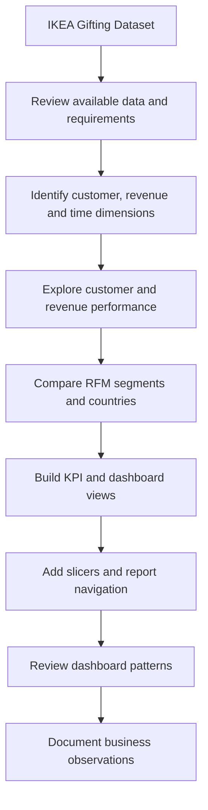

<p align="center">
  
</p>

<h1 align="center">IKEA Customer Analytics</h1>
<h3 align="center">Customer & Revenue Intelligence | Power BI Dashboard</h3>

<p align="center">
  <b>Understand customers. Discover patterns. Drive better business decisions.</b>
</p>

<p align="center">
  
  
  
  
</p>

---

## 📌 Table of Contents

<details open>
<summary><b>Navigate the project</b></summary>

- [Project at a Glance](#-project-at-a-glance)
- [Project Overview](#-project-overview)
- [Business Problem](#-business-problem)
- [Project Objectives](#-project-objectives)
- [Dataset and Analytical Dimensions](#-dataset-and-analytical-dimensions)
- [RFM Analysis Explained](#-rfm-analysis-explained)
- [Dashboard Experience](#-dashboard-experience)
- [Dashboard Gallery](#-dashboard-gallery)
- [Key Performance Indicators](#-key-performance-indicators)
- [Interactive Features](#-interactive-features)
- [Insights from the Dashboard](#-insights-from-the-dashboard)
- [Analytical Workflow](#-analytical-workflow)
- [Technology Stack](#-technology-stack)
- [Repository Structure](#-repository-structure)
- [Getting Started](#-getting-started)
- [Business Opportunities](#-business-opportunities)
- [Limitations and Interpretation](#-limitations-and-interpretation)
- [Future Enhancements](#-future-enhancements)
- [Author](#-author)

</details>

---

## 🎯 Project at a Glance

| Project element | Details |
|---|---|
| Project | IKEA Customer Analytics |
| Business domain | Retail customer and revenue analytics |
| Main platform | Microsoft Power BI |
| Analytical approach | Customer analysis, revenue analysis, RFM segmentation and churn analysis |
| Main report sections | Business Overview and RFM Analysis |
| Dashboard pages | 5-page report export |
| Key dimensions | Month, Quarter, Year, Country, Segment and IsChurned |
| Supporting documentation | Business Requirement Document (BRD) |
| Main deliverable | Dashboard PDF and supporting project resources |

## 🧭 Project Overview

How can customer transaction data help a retail business understand not only how much revenue it generates, but also **who contributes that revenue, how customers behave, and where retention opportunities may exist?**

The **IKEA Customer Analytics** project explores customer behaviour and business performance through a Power BI dashboard. It brings together customer distribution, revenue contribution, churn patterns, RFM-based segmentation and country-level comparisons in one report.

The report is organised into two connected analytical areas:

1. **Business Overview** — examines customer and revenue performance over time and across customer segments.
2. **RFM Analysis** — compares customer segments and countries using Recency, Frequency and Monetary measures.

The goal is to make the available data easier to explore and interpret through clear KPIs, comparative visuals, time-based analysis and interactive report controls.

> **Project scope:** This is a descriptive business intelligence and customer analytics project. It explores patterns represented in the supplied dataset and dashboard; it is not, by itself, a predictive churn model or a causal analysis.

## 💼 Business Problem

Customer count and total revenue are important business measures, but neither tells the whole story on its own. Different customer groups can contribute differently to revenue, purchase activity and churn. Aggregate figures may hide these differences.

This project addresses the following business question:

**How can customer and transaction information be organised into an interactive dashboard that helps compare customer groups, monitor revenue performance and investigate retention patterns?**

The dashboard approaches this question through five analytical perspectives:

| Perspective | What it helps investigate |
|---|---|
| Customer performance | How customers are distributed across segments and periods |
| Revenue performance | How revenue is distributed across segments and time |
| Customer segmentation | How customer groups differ across RFM measures |
| Churn and retention | How churn status varies across segments and periods |
| Geographical analysis | How customer and revenue measures differ by country |

## 🎯 Project Objectives

- Present an at-a-glance view of key customer and revenue indicators.
- Compare customer counts across the available customer segments.
- Examine retained and churned customer patterns by segment.
- Analyse revenue contribution across customer segments.
- Explore monthly, quarterly and yearly customer and revenue trends.
- Apply RFM concepts to compare customer behaviour and value.
- Compare customer and revenue measures across countries.
- Provide report-level filtering and navigation to support exploratory analysis.
- Document the business requirements, dataset resource and report design in one repository.

## 📊 Dataset and Analytical Dimensions

The repository includes the compressed source file **`IKEA Gifting Dataset.zip`**. The dashboard indicates that the analysis uses customer, revenue, time, country, segment and churn dimensions.

The complete source schema, row count and data dictionary are not established by the dashboard export alone. They are therefore not stated as fixed facts here.

### Dimensions visible in the report

| Dimension | Role in the dashboard |
|---|---|
| Month | Monthly customer, revenue and churn comparisons |
| Quarter | Quarterly performance comparisons |
| Year | Year-level trend analysis |
| Country | Geographical comparison and country performance summary |
| Segment | Customer segment comparisons and RFM analysis |
| IsChurned | Filtering and comparing churn status |

### Customer segments shown

The report displays the following segment labels:

- Champions
- Loyal
- At Risk
- New
- Needs Attention
- Lost

The labels are reproduced from the dashboard. Their exact scoring thresholds and assignment rules should be confirmed from the underlying data model or business requirements document before being used operationally.

## 🔍 RFM Analysis Explained

RFM is a customer analysis framework that evaluates customers through three dimensions:

| Dimension | Meaning | Business question |
|---|---|---|
| **Recency (R)** | How recently a customer made a purchase | When did the customer last purchase? |
| **Frequency (F)** | How often a customer purchased during the observation period | How often does the customer purchase? |
| **Monetary (M)** | The monetary value associated with a customer's purchases | How much value does the customer contribute? |

### Why RFM matters

Considering Recency, Frequency and Monetary measures together can provide a richer view of customer behaviour than considering a single measure in isolation. It can help distinguish customer groups for further investigation, such as highly engaged customers, recently acquired customers and groups that may need retention attention.

The dashboard's RFM pages compare segment-level and country-level summaries, including average R, average F and average M scores, total customers and total revenue.

**Interpretation note:** RFM scores and segment labels depend on the scoring method and thresholds used in the underlying model. The dashboard export does not document those thresholds in sufficient detail to reproduce them here.

## 🖥️ Dashboard Experience

The report is organised as a five-page experience:

| Page | Dashboard section | Main purpose |
|---|---|---|
| 1 | IKEA Customer Analytics | Landing page, module navigation and key-metric glossary |
| 2 | Business Overview — Customer | Customer distribution, retention and time trends |
| 3 | RFM Analysis — Segment | Segment performance, average customer value and churn trends |
| 4 | Business Overview — Revenue | Revenue contribution by segment and time trends |
| 5 | RFM Analysis — Country | Country performance and top-country customer value |

### 1. Landing Page — IKEA Customer Analytics

The opening page introduces the two main report areas: **Business Overview** and **RFM Analysis**. It also includes a key-metrics glossary for Churned %, Recency, Frequency, Monetary and Customer Value.

### 2. Business Overview — Customer Analysis

This page focuses on customer volume and retention. The visuals include:

- Total customers by segment.
- Customer retention by segment, split by churn status.
- Total customers by month.
- Total customers by quarter.
- Total customers by year.

These views allow the user to compare customer distribution and investigate how customer counts and churn patterns vary across segments and time periods.

### 3. RFM Analysis — Segment Analysis

This page presents a segment performance summary with total customers, total revenue and average R, F and M scores. It also includes average customer value by segment and churn trends by month, quarter and year.

The segment summary supports comparisons between customer groups rather than relying on total customer count alone.

### 4. Business Overview — Revenue Analysis

This page focuses on revenue contribution and revenue trends. The visuals include:

- Total revenue by segment.
- Revenue contribution by segment.
- Total revenue by month.
- Total revenue by quarter.
- Total revenue by year.

The page makes it possible to compare customer volume with revenue contribution and investigate how revenue changes over time.

### 5. RFM Analysis — Country Analysis

This page presents a country performance summary with total customers, total revenue and average R, F and M scores. It also includes a top-five country comparison by average customer value and churn trends over time.

This view supports geographical comparisons while keeping customer value and revenue in the same analytical context.

## 🖼️ Dashboard Gallery

The following images are taken from the supplied five-page dashboard preview. They are included as separate repository assets so visitors can inspect the report directly on GitHub.

### Page 1 — Project Overview


### Page 2 — Business Overview: Customer


### Page 3 — RFM Analysis: Segment


### Page 4 — Business Overview: Revenue


### Page 5 — RFM Analysis: Country


### View the complete dashboard PDF

The complete five-page export is available here:

📄 **[Open IKEA Dashboard as PDF](IKEA%20Dashboard%20as%20pdf.pdf)**

> GitHub README files display image files directly, but do not render a PDF as an inline interactive report. The PDF link above lets readers open the complete exported report. The page images provide an immediate visual preview within the README.

## 📌 Key Performance Indicators

The Business Overview page displays the following headline metrics in the exported dashboard view:

| KPI | Value shown | What it represents |
|---|---:|---|
| Total Customers | 5,881 | Customer count in the displayed report view |
| Total Revenue | $17.4M | Revenue in the displayed report view |
| Churned % | 50.86% | Churn percentage shown in the report |
| Average Customer Value | 2,954 | Average customer value shown in the report |

These are the values visible in the supplied dashboard export. They may change under report filters. The precise unit and calculation definition for Average Customer Value should be checked against the underlying model or BRD before being interpreted beyond the displayed label and value.

## 🎛️ Interactive Features

The dashboard export shows the following report controls and navigation elements:

### Global slicers

| Slicer | Intended use |
|---|---|
| Month | Filter the report by month |
| Quarter | Filter the report by quarter |
| Year | Filter the report by year |
| Country | Focus the analysis on a country |
| Segment | Focus the analysis on a customer segment |
| IsChurned | Filter by churn status |

### View switching and navigation

- **Business Overview / RFM Analysis:** Navigate between the two main report areas.
- **Customer / Revenue:** Switch the Business Overview analysis between customer and revenue perspectives.
- **Segment / Country:** Switch the RFM analysis between segment-level and country-level perspectives.
- **Clear All Slicers:** Reset filter selections and return to an unfiltered report view.

The PDF is a static export and does not retain live Power BI interactions. To use the slicers and navigation controls, the original Power BI report file is required. A `.pbix` file was not among the repository files shown for this project.

## 💡 Insights from the Dashboard

The following are descriptive observations from the supplied dashboard export, not causal conclusions or predictions.

1. **Customer distribution differs by segment.** The customer page shows variation in customer counts across Champions, Loyal, At Risk, New, Needs Attention and Lost.
2. **Retention patterns differ across segments.** The customer retention chart compares churn status across the displayed customer groups, making segment-level retention investigation possible.
3. **Revenue contribution is not uniform.** The revenue page shows Champions as the largest revenue-contributing segment in the displayed view.
4. **Revenue varies over time.** Monthly, quarterly and yearly visuals provide complementary views of revenue performance. In the exported yearly chart, 2010 is the highest of the three displayed years.
5. **Customer value varies by country.** The country page compares average customer value across countries and highlights the top five in the displayed view.
6. **RFM measures add customer context.** The segment and country summaries place customer count and revenue alongside average Recency, Frequency and Monetary scores.

Always interpret rates alongside their underlying customer counts. A percentage calculated from a small segment can be less stable than a percentage based on a larger group.

## 🔄 Analytical Workflow



The repository includes the dataset archive, Business Requirement Document, Power BI theme file and PDF dashboard export. The exact transformation steps and DAX definitions are not included in the visible file list, so this workflow describes the analytical structure rather than claiming a specific undocumented implementation.

## 🧰 Technology Stack

| Tool / Resource | Role in the project |
|---|---|
| Microsoft Power BI | Dashboard design, data exploration and visual reporting |
| DAX | Power BI measure and calculation language, where used in the report model |
| Power Query | Power BI data preparation environment, if used in the underlying report |
| JSON | Format of the supplied Power BI theme file |
| Microsoft Word | Business requirement documentation (`IKEA BRD.docx`) |
| GitHub | Project hosting, version control and documentation |

## 📁 Repository Structure

The following structure reflects the files shown in the project repository, with an `assets/` folder added for the dashboard page images used in this README:

```text
IKEA-Customer-Analytics/
│
├── assets/
│   ├── 01-dashboard-overview.png
│   ├── 02-business-customer.png
│   ├── 03-rfm-segment.png
│   ├── 04-business-revenue.png
│   └── 05-rfm-country.png
│
├── Background Images.zip
├── IKEA BRD.docx
├── IKEA Dashboard as pdf.pdf
├── IKEA Gifting Dataset.zip
├── IKEA Project Theme.json
├── LICENSE
└── README.md
```

Keep the original filenames unchanged if you use the relative links in this README. GitHub paths are case-sensitive, so the names and folder locations must match exactly.

## 🚀 Getting Started

### 1. Clone or download the repository

Open the repository on GitHub and use **Code → Download ZIP**, or clone it using the repository URL:

```bash
git clone <YOUR-GITHUB-REPOSITORY-URL>
cd <YOUR-REPOSITORY-FOLDER>
```

Replace the placeholders with the actual repository URL and folder name.

### 2. Review the project documentation

Open `IKEA BRD.docx` to review the business requirements and `README.md` for the project overview.

### 3. Extract the dataset

Extract `IKEA Gifting Dataset.zip` to access the supplied dataset files. The exact source filename and schema should be confirmed after extraction.

### 4. Review the Power BI theme

The repository includes `IKEA Project Theme.json`. In Power BI Desktop, use the report theme import option to apply the supplied JSON theme, if required.

### 5. View the dashboard

Open `IKEA Dashboard as pdf.pdf` to review the five-page report export. The separate images in `assets/` are included for quick viewing on GitHub.

**To interact with the report:** use the original Power BI `.pbix` file if it is available to you. The PDF export is for viewing and does not contain working slicers or navigation interactions.

## 💼 Business Opportunities

The dashboard can support further investigation into opportunities such as:

| Area | Follow-up question |
|---|---|
| Customer retention | Which segments show the greatest churn share, and how many customers are represented? |
| High-value customers | What behaviours distinguish the segments with higher average customer value? |
| Revenue concentration | How dependent is total revenue on the largest contributing segment? |
| Customer engagement | How do Recency and Frequency differ across customer segments? |
| Geographical performance | Which countries combine customer scale with higher average customer value? |
| Time trends | Are changes in revenue and churn consistent across months, quarters and years? |

These are analytical opportunities suggested by the available dashboard views. They should be investigated with the underlying data before making operational decisions.

## ⚠️ Limitations and Interpretation

- The dashboard is descriptive; it does not establish that a customer characteristic causes churn or revenue differences.
- KPI values shown in the README are from the exported default view and may change when filters are applied.
- The precise dataset row count, column count and full field definitions are not specified here because they are not confirmed by the dashboard export.
- RFM segment thresholds and scoring rules should be verified from the underlying model or BRD.
- Churn interpretation depends on how `IsChurned` is defined and on the observation window.
- Revenue and churn rates should be read alongside customer counts and the period being analysed.
- Country comparisons may be affected by differences in customer volume and data coverage.
- The PDF and page images are static. Live interaction requires the original Power BI report.

## 🔮 Future Enhancements

Potential extensions to the project include:

- Adding a documented data dictionary and dataset profile.
- Publishing the `.pbix` file, if sharing is permitted.
- Documenting DAX measures and RFM scoring thresholds.
- Adding customer cohort and repeat-purchase analysis.
- Exploring customer lifetime value with a clearly defined calculation.
- Developing a separately validated churn prediction model.
- Adding drill-through pages for detailed segment and country investigation.
- Including customer counts in tooltips alongside percentages and rates.
- Documenting data refresh steps and the reporting period.

## 👩‍💻 Author

**Vanshika Kumar**  
Statistics (Hons.) | Ramjas College, University of Delhi

Interested in applying statistics, analytics and business intelligence to practical business questions through data exploration, analytical thinking and visual storytelling.

- **GitHub:** [Vanshika26Ramjas](https://github.com/Vanshika26Ramjas)
- **LinkedIn:** Add your LinkedIn profile URL here.

---

<p align="center">
  <b>From customer data to business understanding.</b><br/>
  Explore. Analyse. Discover. Make better-informed decisions.
  <br/><br/>
  ⭐ If you find this project interesting, consider starring the repository.
</p>

